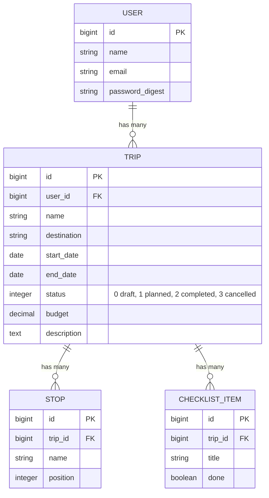

# TravelTracker

Rails-приложение для планирования поездок: поездки, остановки маршрута и пункты подготовки.

## Запуск

    bundle install
    bin/rails db:migrate
    bin/rails server

Приложение откроется на http://localhost:3000. Страница с элементами интерфейса: `/ui-kit`.

## Тесты

    bin/rails test test/models

Тесты моделей лежат в `test/models/`:

- `trip_test.rb`: длительность поездки, метка «Скоро», процент готовности, смена статусов, валидации
- `stop_test.rb`: автоматическая нумерация остановок, перенумерация после удаления, каскадное удаление
- `checklist_item_test.rb`: значение по умолчанию, переключение отметки, валидации

## Схема базы данных

## Модели

**User** — пользователь приложения. Ему принадлежат поездки (`has_many :trips`).

**Trip** — поездка. Статусы: черновик, запланирована, завершена, отменена.
Методы бизнес-логики:

- `duration_days` — сколько дней длится поездка (включая первый и последний)
- `soon?` — запланированная поездка стартует в ближайшие 14 дней
- `progress_percent` — процент выполненных пунктов подготовки
- `complete` — завершить запланированную поездку
- `cancel` — отменить поездку (завершённую отменить нельзя)
- `restore_to_draft` — вернуть отменённую поездку в черновики

**Stop** — остановка маршрута. Новая остановка автоматически встаёт в конец списка, а после удаления номера остальных пересчитываются без пропусков.

**ChecklistItem** — пункт подготовки к поездке (билеты, отель, виза). Метод `toggle_done!` переключает отметку о выполнении.